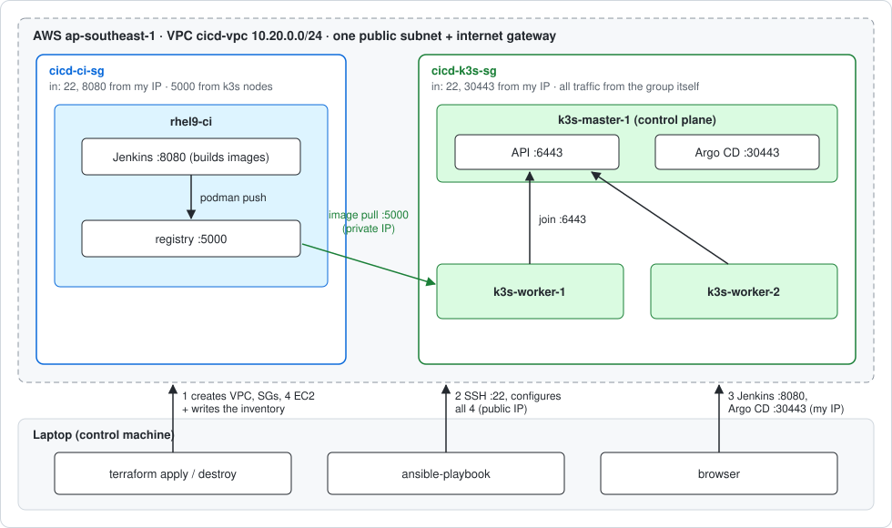

# CI/CD Lab Environment

A ready-to-use CI/CD environment on AWS, built from code: **Terraform** creates the servers, **Ansible** installs the tools. One CI host builds container images (Jenkins + a private registry), a k3s cluster with Argo CD runs them. It is the base for practicing CI/CD pipelines on real applications.



*Terraform builds the network and 4 RHEL 9 instances and writes the inventory; Ansible configures them; only my IP reaches SSH, Jenkins and Argo CD.*

## What you get

| Host | Runs |
| --- | --- |
| `rhel9-ci` | Jenkins (builds images with rootless Podman), registry on port 5000 |
| `k3s-master-1` | k3s control plane, Argo CD UI on port 30443 |
| `k3s-worker-1`, `k3s-worker-2` | k3s workers |

- Same result on every run: a rerun of the playbook reports `changed=0`.
- Stop it when not in use (only the disks are billed), destroy it to pay nothing, rebuild it in minutes.

## Repository layout

```text
terraform/            AWS: VPC, security groups, 4 EC2 instances, writes the inventory
playbooks/            main_playbook.yml: registry + Jenkins, then k3s server, then k3s agents
sysconfig/            inventories and group_vars (settings for the roles)
requirements.yml      the 3 roles (registry, jenkins, k3s), each in its own repository
docs/                 overview and how-to
runs/                 saved run logs (test evidence)
```

## Quick start

All commands from the repository root; details and the stop/start switch in [docs/usage.md](docs/usage.md).

```bash
terraform -chdir=terraform init
terraform -chdir=terraform apply
ansible-galaxy install -r requirements.yml -p roles/ --force
ansible-playbook -i sysconfig/inventory-aws.yml playbooks/main_playbook.yml
```

## Documentation

- [docs/overview.md](docs/overview.md): what the parts are and how they connect.
- [docs/usage.md](docs/usage.md): step by step, in batches: set up once, build, configure, check, stop, start, destroy.
- The roles document themselves: [ansible-role-registry](https://github.com/bunnywkwk/ansible-role-registry), [ansible-role-jenkins](https://github.com/bunnywkwk/ansible-role-jenkins), [ansible-role-k3s](https://github.com/bunnywkwk/ansible-role-k3s).

## Status

Done: the environment builds on AWS with Terraform, the playbook runs green on it (rerun `changed=0`), Argo CD is reachable, and the stop switch works. Not in scope yet: applications and their pipelines, Argo CD Applications, a TLS registry.
