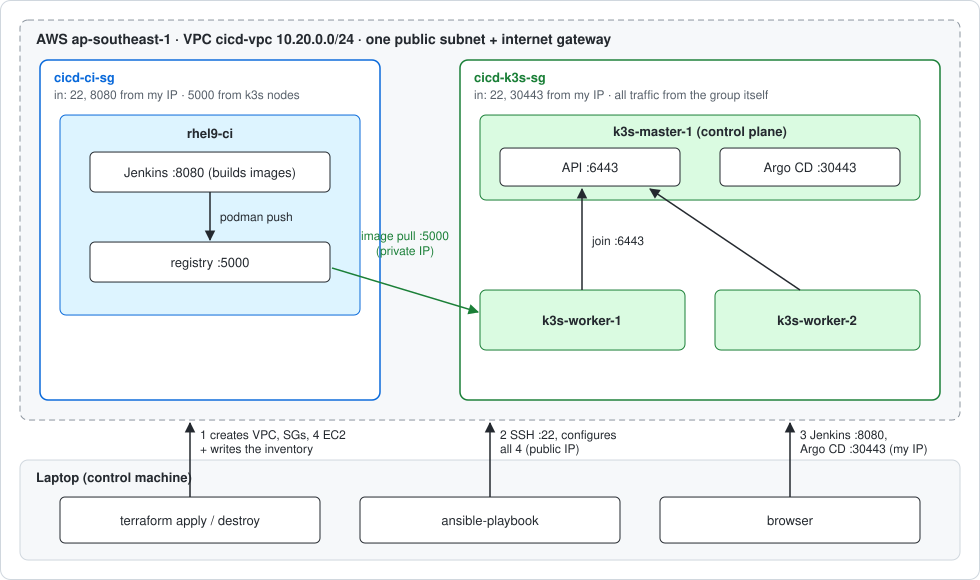

# Overview

**Goal:** one command builds the servers, one command configures them, and the result is a working CI/CD environment: CI builds and stores images, CD runs them on Kubernetes.

## The parts

| Part | Where | What it does |
| --- | --- | --- |
| Terraform | `terraform/` | Creates the AWS side and writes `sysconfig/inventory-aws.yml` with the IPs |
| Playbook | `playbooks/main_playbook.yml` | Runs the 3 roles in order: registry + Jenkins, k3s server, k3s agents |
| `registry` role | `rhel9-ci` | `registry:2` under Podman Quadlet, port 5000, plain HTTP, no login |
| `jenkins` role | `rhel9-ci` | Jenkins LTS, configured as code (no setup wizard), rootless Podman to build and push images |
| `k3s` role | 3 k3s nodes | k3s (1 server + 2 agents), SELinux on, Argo CD installed on the server |

## AWS resources (`terraform/`)

| File | Creates |
| --- | --- |
| `network.tf` | VPC `10.20.0.0/24`, one public subnet `10.20.0.0/28`, internet gateway, route table |
| `access.tf` | Key pair from `~/.ssh/id_rsa.pub`; security groups `cicd-ci-sg` and `cicd-k3s-sg` |
| `instances.tf` | `rhel9-ci` (`m7i-flex.large`, 20 GiB), 3 k3s nodes (`c7i-flex.large`, 15 GiB), RHEL 9.8 image; the on/off switch |
| `inventory.tf` | The Ansible inventory and the `instances` output |
| `variables.tf` | Region (`ap-southeast-1`), image, instance types, key path, `running` |

## Who can reach what

| Port | Open to | For |
| --- | --- | --- |
| 22 | my IP (looked up by Terraform at every apply) | Ansible and SSH |
| 8080 on `rhel9-ci` | my IP | Jenkins UI |
| 30443 on `k3s-master-1` | my IP | Argo CD UI |
| 5000 on `rhel9-ci` | the k3s nodes only | image pulls |
| everything between k3s nodes | the k3s nodes only | join (6443), pod network, kubelet |

Each instance also runs firewalld (installed by the roles) with the same ports.

## Design choices

- **Two IPs per instance.** The public IP is for me (SSH, browser) and changes on every stop/start. The hosts talk to each other on the private IP (`private_ip` in the inventory), which never changes, so the cluster survives a stop/start.
- **Public subnet, no NAT gateway.** All 4 instances need the internet for packages and images; a NAT gateway costs money every hour. The security groups keep everything closed except to my IP.
- **Pinned RHEL 9.8 image.** Every build gets the OS the roles were tested on.
- **Terraform writes the inventory.** No IPs copied by hand; new host keys are accepted on first contact (`StrictHostKeyChecking=accept-new`), a changed one is still refused.
- **The same playbook works on local VMs.** `sysconfig/inventory.yml` is the KVM version; without `private_ip`, the settings fall back to `ansible_host`.

## Lab-only shortcuts

- The registry is plain HTTP without login: reachable only from the k3s nodes.
- Jenkins admin password defaults to `admin` unless set with ansible-vault ([usage](usage.md#optional-own-jenkins-password)): reachable only from my IP.
- One public subnet in one zone, no high availability.
